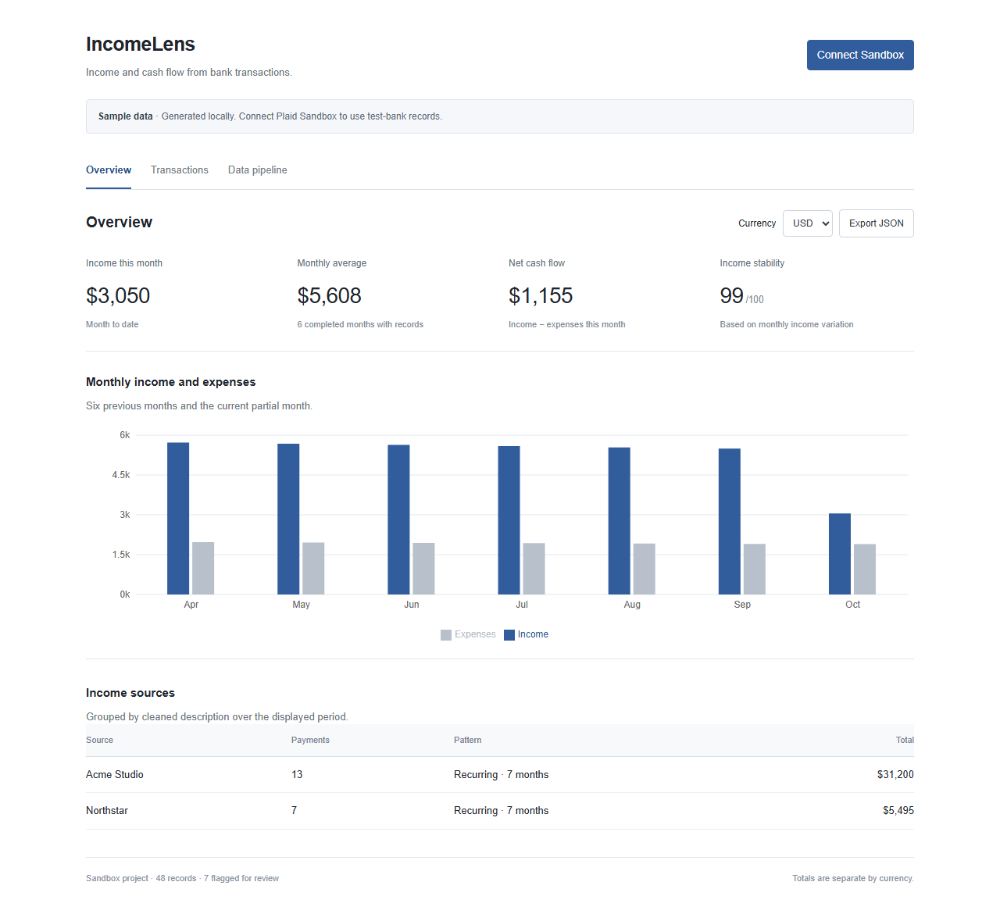

# IncomeLens

A small app that turns bank transactions into monthly income and cash-flow summaries.

**Live app:** https://incomelens-olive.vercel.app



## Run locally

Use Node.js 22 or newer:

```sh
npm ci
npm run dev
```

Open http://127.0.0.1:3000. Sample data works without any accounts or keys.

## Where the code lives

| File                               | Job                                                            |
| ---------------------------------- | -------------------------------------------------------------- |
| `app/page.tsx`                     | Page navigation, data state and connection buttons             |
| `components/income-chart.tsx`      | Monthly bar chart                                              |
| `components/transaction-table.tsx` | Search, filters and transaction rows                           |
| `lib/pipeline.ts`                  | Clean descriptions, classify transactions and calculate totals |
| `lib/plaid.ts`                     | Server-side Plaid requests and encrypted connection cookie     |
| `app/api/plaid/route.ts`           | Link, exchange, sync and disconnect actions                    |
| `app/globals.css`                  | Layout and styling                                             |

There is no database or AI model. The income rules are ordinary TypeScript functions. The chart and both transaction views use the same cleaned records.

## How Plaid Sandbox connects

1. Click **Connect Sandbox**. Our server requests a short-lived Link token from Plaid.
2. Plaid opens its login window. Choose a test bank and enter fake credentials.
3. Plaid returns a public token. Our server exchanges it for a private access token.
4. The server uses that access token to request simulated transactions.
5. Our cleaning rules process those records and the page updates.

The access token stays in an encrypted HttpOnly cookie. Credentials stay in server environment variables. Nothing here connects to real banks: the server URL is fixed to Plaid Sandbox.

To enable this flow, create a Plaid developer account at https://dashboard.plaid.com/signup. Copy `.env.example` to `.env.local` and fill in `PLAID_CLIENT_ID`, the Sandbox `PLAID_SECRET`, and a random `SESSION_SECRET` of at least 32 characters. Never commit that file or paste secrets into chat. Restart the server after changing environment variables.

In Vercel, add the same variables under **IncomeLens → Settings → Environment Variables**, then redeploy. For a non-OAuth test bank such as First Platypus Bank, the sample login is `user_good` / `pass_good`. If transactions are still being prepared, press **Refresh** after a short wait.

## Calculation rules

- Plaid uses negative amounts for incoming money. A posted credit counts as income if its category or description supports it.
- Transfers, refunds and pending records are excluded. Unknown credits are flagged for review.
- Net cash flow means classified income minus expenses. It excludes transfers and unknown credits.
- Totals are separate by currency. There is no exchange-rate conversion.
- Stability is `max(0, 100 × (1 − standard deviation / average))`, using completed months with records. It needs at least three months. Months with activity but no income count as zero; absent history is skipped.
- A source is marked recurring if it appears in three distinct months. This does not predict payday.

Description matching can make mistakes. The current month is partial. The stability score describes observed variation; it does not assess creditworthiness or predict future income. Exported confidence values are fixed rule labels, not statistical probabilities.

## Storage

Transactions live in page memory. Refreshing the page returns to sample data. The connection cookie expires after two hours. While the connection is open, **Refresh** fetches transactions again and **Disconnect** removes the Plaid Item and clears the cookie. **Show sample data** changes the display without disconnecting.

Each sync starts from the initial cursor, applies added/modified/removed records, and retries if Plaid changes pages during pagination. This keeps the example small. A larger app would store a per-user cursor and transaction history in a database.

## Checks

```sh
npm test
npm run typecheck
npm run build
# With npm run dev running in another terminal:
npx playwright install chromium
npx playwright test tests/browser.spec.ts --workers=1
```

Tests cover income signs, pending payments, transfers/refunds, duplicates, invalid values, currencies, future dates and incomplete history. Browser checks cover navigation, search, filters, export, missing configuration and mobile layout. GitHub Actions runs unit tests and the production build.

## Deployment

The private GitHub repository is connected to the Vercel `incomelens` project. Pushes to `main` trigger a production deployment. No environment variables are needed for sample mode. Live Sandbox ingestion still needs Plaid developer credentials and has not been verified against a configured Plaid account.

This is a Sandbox learning project. Real banking would need user accounts, durable encrypted storage, rate limits, signed webhooks, consent/deletion handling and monitoring.

Docs: https://plaid.com/docs/quickstart/ · https://plaid.com/docs/api/transactions/#transactionssync
