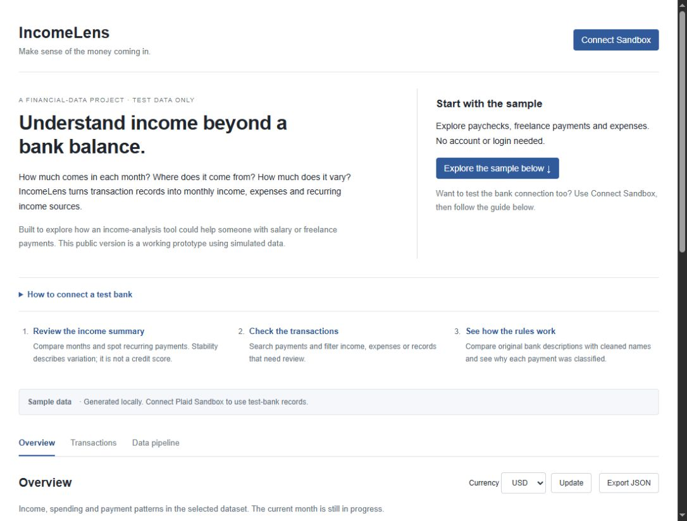

# IncomeLens

Understand monthly income, recurring payment sources and cash flow, with rules you can inspect. Built in Python 3.12 with FastAPI and Plaid Sandbox.

**Live app:** https://incomelens-olive.vercel.app

## What to do in the app

IncomeLens explores how bank transactions can answer three questions: how much income arrives each month, where it comes from, and how much it varies. It is a working prototype for salary and freelance income analysis, using simulated records only.

Start with the sample dataset; no login is required. Review the Overview, search and filter Transactions, then open Data pipeline to compare original descriptions with cleaned names and classification rules. The page includes a separate Plaid Sandbox guide for testing the bank connection. Test banks may have no transactions or income, so sample data is the easiest way to explore all features. Stability describes past income variation; it is not a credit score or forecast.



## Run it

Install Python 3.12, then:

```sh
python -m venv .venv
# Windows:
.venv\Scripts\activate
# macOS / Linux: source .venv/bin/activate
pip install -r requirements.txt
python -m uvicorn app:app --reload --port 8000
```

Open http://127.0.0.1:8000. Sample data works without accounts or secrets.

## Four files to understand

| File | What to read it for |
| --- | --- |
| `app.py` | Routes: show a page, export records, connect/disconnect Plaid |
| `pipeline.py` | Clean descriptions, classify records, calculate monthly totals |
| `plaid.py` | Call Plaid Sandbox, read its pages, encrypt the connection cookie |
| `views.py` | Generate the page and bar chart |

Start with `pipeline.py`: `clean_transactions()` turns raw records into labeled records; `analyze()` computes the summaries; `demo_transactions()` supplies example data. These are ordinary functions that use lists and dictionaries.

The page is rendered on the server. Clicking a tab or applying a filter requests another page. The chart is an SVG generated by Python; it needs no chart library. There is no React, Next.js, TypeScript, npm or frontend build step.

**Python-first does not mean browsers run Python.** `views.py` emits HTML and includes a short CSS block for appearance. Its small JavaScript callback opens Plaid's web login window and sends the result to Python. That browser glue is the only application JavaScript; all data processing and page rendering are Python. Keeping it in one file avoids a separate frontend project, though the embedded HTML/CSS still use browser syntax.

## How Sandbox connects

1. Click **Connect Sandbox**. Python requests a Link token from Plaid.
2. Plaid opens a fake-bank login window.
3. The browser sends the returned public token to Python.
4. Python exchanges it for a private access token and encrypts it in an HttpOnly cookie.
5. Python fetches simulated transactions, applies the rules and renders the page.

Create a developer account at https://dashboard.plaid.com/signup. Copy `.env.example` to `.env.local`, and fill in `PLAID_CLIENT_ID`, the **Sandbox** `PLAID_SECRET`, and a random `SESSION_SECRET` of at least 32 characters. Generate that secret locally with `python -c "import secrets; print(secrets.token_urlsafe(32))"`. Keep the result private. Restart after editing environment variables.

On Vercel, add those same three variables under **IncomeLens → Settings → Environment Variables** and redeploy. Never put them in GitHub, chat, screenshots or logs.

For a transaction-focused test account, search for **First Platypus Bank**, use username `user_transactions_dynamic` and password `pass_good`, then select a checking account. If Plaid asks for a phone number, skip the step if offered, or use the Sandbox profile `415-555-0136` with verification code `123456`. No text message will arrive. These are public test details, not real account credentials. See [Plaid's test credentials](https://plaid.com/docs/sandbox/test-credentials/) and [Sandbox phone profiles](https://plaid.com/docs/link/returning-user/#testing-in-sandbox).

If transaction history is still loading, press **Refresh** shortly afterward. A connected test account may have no transactions or paychecks; the app explains this instead of showing empty history as zero income. Choose sample data to explore regular payroll and freelance income without a bank connection.

## Rules and limits

- Plaid uses negative amounts for incoming money. A posted credit counts as income when its category or description indicates income.
- Exclude transfers, refunds and pending records. Flag unrecognized credits for review.
- Deduplicate by transaction ID, keeping the latest version. Invalid dates and non-finite amounts are dropped.
- Net cash flow is classified income minus expenses; it excludes unknown credits and transfers.
- Keep currencies separate; no exchange-rate conversion.
- The chart covers six previous months plus the current partial month.
- Stability is `max(0, 100 × (1 − standard deviation / average))`. It uses completed months with records and needs at least three. An expense-only month counts as zero income; absent history is skipped.
- A source is recurring if it appears in three distinct months. Text grouping can merge or split sources incorrectly. This is not a payday forecast or credit assessment.

## Storage and security

